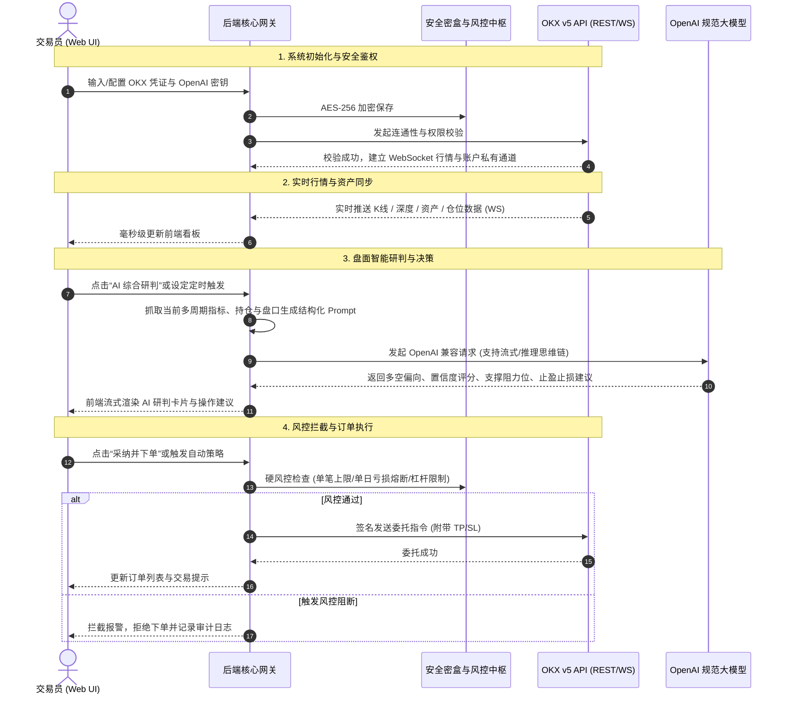
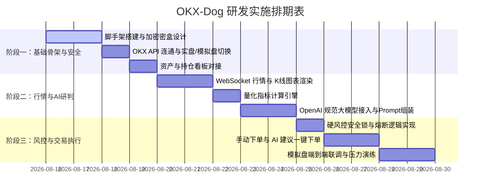

# OKX-Dog 个人量化分析与智能决策系统
## 产品需求规格说明书 (Product Requirements Document - PRD)

| 文档版本 | 编写日期 | 状态 | 适用对象 |
| :--- | :--- | :--- | :--- |
| **v1.0.0** | 2026-08-15 | 正式发布 | 系统架构师 / 前后端研发 / 个人交易员 |

---

## 1. 产品背景与目标定位

### 1.1 业务背景与痛点
在数字货币量化交易与日常盯盘过程中，个人交易员面临以下核心痛点：
1. **资金与密钥安全隐患**：第三方量化云平台存在 API Key 泄漏、托管风险及被动提现风险，个人私有化部署并实行最小权限隔离是根本保障。
2. **情绪化与主观交易陷阱**：在极端行情下容易发生追涨杀跌、扛单或未严格设置止损止盈等情绪化行为，缺乏系统级硬风控限制。
3. **多维信息整合负荷高**：需要同时关注多周期技术指标（EMA/MACD/RSI）、衍生品指标（资金费率、持仓量 OI、多空比）和即时盘口深度，人工分析耗时且容易遗漏关键信号。
4. **AI 大模型决策赋能门槛**：市面上缺乏将 **标准 OpenAI 协议大模型（如 DeepSeek-R1/V3、GPT-4o、Claude 等）** 与 **实时行情结构化上下文** 深度融合、输出结构化交易研判与决策建议的专属本地系统。

### 1.2 产品定位与愿景
**OKX-Dog** 是一款**专为个人量化操盘手打造的私有化、金融级安全、集“实时行情监控 + 资产与持仓看板 + 硬风控熔断 + 大模型智能研判 + 自动化交易执行”于一体的综合决策控制台**。
* **核心关键词**：`金融级安全`、`OpenAI 兼容生态`、`实时低延迟`、`人机协同决策`、`多重硬风控`、`暗黑专业 UI`。

### 1.3 核心设计原则
* **安全第一 (Security-First)**：API Key 仅开放只读/交易权限（绝对物理隔离提现权限）；本地 AES-256 密盒加密存储；硬风控阻断异常交易。
* **实时与可靠 (Real-Time & Resilience)**：WebSocket 毫秒级数据流驱动，网络断线自动重连，API 限频自适应退避。
* **灵活可扩展的 AI 生态 (LLM-Agnostic)**：严格遵循 OpenAI 标准接口规范，用户可自由接入任何兼容厂商的 BaseURL / Key / Model。
* **人机协同与可控 (Human-in-the-Loop)**：AI 负责提供多维度研判、支撑压力区间与风控建议；系统提供“手动一键采纳”、“半自动审批”与“小额全自动”多档模式。

---

## 2. 用户画像与核心业务流程

### 2.1 用户画像
* **角色**：独立个人交易员 / 量化爱好者。
* **核心诉求**：
  * 掌握所有资产与持仓的实时动态，拒绝信息延迟。
  * 在开仓前获得大模型结合当前多周期指标给出的客观胜率与盈亏比研判。
  * 通过硬风控锁死单日最大亏损和最大杠杆，杜绝爆仓。

### 2.2 核心业务流程图



---

## 3. 功能需求详细规格 (Functional Requirements)

### 模块一：安全控制与凭证管理中心 (Security & Vault)

| 功能 ID | 功能名称 | 详细说明 | 优先级 |
| :--- | :--- | :--- | :--- |
| **FR-1.1** | **OKX 凭证密盒** | 1. 支持输入 `API Key`、`Secret Key`、`Passphrase`。<br>2. 支持切换 `实盘环境 (Live)` 与 `模拟盘环境 (Demo/Sandbox)`。<br>3. 凭证采用 AES-256-GCM 算法本地加密落库，前端仅显示脱敏掩码（如 `****abcd`）。<br>4. 提供“一键测试连通性”功能，校验权限范围（检测是否只包含读取/交易，若开启提现权限则弹出强安全警告）。 | P0 (最高) |
| **FR-1.2** | **OpenAI 规范大模型配置** | 1. 支持配置 `Base URL`（如 `https://api.deepseek.com`、`https://api.openai.com/v1` 等）。<br>2. 支持配置 `API Key`（加密存储）、`Model Name`（如 `deepseek-chat`, `deepseek-reasoner`, `gpt-4o`, `qwen-max`）。<br>3. 支持自定义 `Temperature`、`Max Tokens` 与系统 Prompt 模板。<br>4. 提供模型响应连通性与延迟测试按钮。 | P0 |
| **FR-1.3** | **多重硬风控安全锁 (Risk Lock)** | 1. **单笔最大下单金额**：超过设定 USDT 上限直接拦截。<br>2. **单日最大亏损熔断**：当日累计已实现+浮动亏损达到阈值（如总资产 5%）时，强制锁定交易面板，取消挂单。<br>3. **最大杠杆硬锁**：合约交易强制锁定最高杠杆（如 ≤ 5x），防止误操作。<br>4. **滑点保护**：市价单偏离当前标记价超过阈值（如 0.5%）时自动撤销。 | P0 |
| **FR-1.4** | **紧急全平与撤单 (Panic Button)** | 顶部导航栏提供显眼的“紧急熔断”按钮，双重确认后立即向 OKX 批量发送**撤销所有活动挂单**及**所有持仓市价全平**指令。 | P0 |

---

### 模块二：资产与持仓实时监控看板 (Asset & Position Dashboard)

| 功能 ID | 功能名称 | 详细说明 | 优先级 |
| :--- | :--- | :--- | :--- |
| **FR-2.1** | **账户资产全景看板** | 1. 展示账户总资产估值（折合 USDT / BTC）、可用余额、冻结资金、保证金占用。<br>2. 区分展示“交易账户”与“资金账户”资产分布。<br>3. 实时计算当日收益（Today PnL）、当日收益率，并绘制账户历史资金权益曲线。 | P0 |
| **FR-2.2** | **持仓实时深度监控** | 1. 列表展示当前所有活跃持仓（现货/永续/交割）：标的、持仓方向（多/空）、持仓数量、杠杆倍数、开仓均价、最新标记价、未实现盈亏 (USDT/百分比)、预估强平价、保证金率。<br>2. 风险预警高亮：当保证金率接近预警线时，以醒目颜色和声音告警。<br>3. 快捷调仓：支持一键市价平仓、限价平仓、追加/减少保证金。 | P0 |
| **FR-2.3** | **持仓止盈止损管理** | 支持在持仓列表中直接为任意仓位快速设定/修改/取消止盈价（Take-Profit）与止损价（Stop-Loss），触发时由 OKX 服务器自动委托。 | P0 |

---

### 模块三：行情监控与技术指标引擎 (Market Data & Indicators)

| 功能 ID | 功能名称 | 详细说明 | 优先级 |
| :--- | :--- | :--- | :--- |
| **FR-3.1** | **专业多周期 K 线图表** | 1. 集成 TradingView / Lightweight Charts 图表，支持流畅缩放与十字光标。<br>2. 支持主流周期切换：`1m`、`5m`、`15m`、`1h`、`4h`、`1d`。<br>3. 在图表上直观标注：用户当前持仓均价线、止盈止损线、AI 建议的关键阻力/支撑位。 | P0 |
| **FR-3.2** | **量化技术指标实时计算** | 后端自动计算并支持在图表中叠加：<br>- 均线系统：EMA(20, 50, 200), SMA<br>- 动量指标：MACD (12, 26, 9), RSI (14)<br>- 波动通道：布林带 Bollinger Bands (20, 2), ATR (14)<br>- 成交量与量比分析 | P0 |
| **FR-3.3** | **订单簿深度与大单流水** | 1. 实时展示 Level-2 深度盘口（买卖各 20 档），可视化买卖盘厚度比例。<br>2. 实时 Ticker 变动与大单（>设定阈值）异动闪烁提示。 | P1 |
| **FR-3.4** | **衍生品专项指标监控** | 1. 资金费率（Funding Rate）：当前费率、倒计时、历史费率走势，辅助资金费率套利研判。<br>2. 全网未平仓合约量 (Open Interest - OI) 变动监测。<br>3. 多空持仓人数比与大户多空持仓比。 | P1 |

---

### 模块四：大模型智能研判与决策中心 (LLM Decision Engine)

| 功能 ID | 功能名称 | 详细说明 | 优先级 |
| :--- | :--- | :--- | :--- |
| **FR-4.1** | **行情结构化 Prompt 组装器** | 后端自动收集以下实时数据并构造成结构化 JSON 提示词：<br>1. 标的信息、当前价格、24h 涨跌幅、波动率。<br>2. 15m / 1h / 4h / 1d 多周期技术指标值（EMA趋势、RSI超买超卖、MACD金叉死叉、布林带位置）。<br>3. 衍生品数据（资金费率偏离度、持仓量 OI 增减趋势）。<br>4. 当前账户持仓与剩余可用保证金。<br>5. 交易员设定的交易偏好（激进 / 稳健 / 趋势跟踪 / 震荡套利）。 | P0 |
| **FR-4.2** | **AI 结构化研判输出** | 规范大模型通过 Structured Outputs (JSON Schema) 返回标准化结果：<br>1. **方向研判**：`多头 (LONG)` / `空头 (SHORT)` / `观望 (NEUTRAL)`。<br>2. **信号置信度**：0 ~ 100 分。<br>3. **关键位置**：强支撑位 $S_1, S_2$、强阻力位 $R_1, R_2$。<br>4. **建议交易计划**：推荐入场区间、推荐止损价（基于 ATR 或前高低点）、第一目标止盈位、第二目标止盈位、理论盈亏比 (R:R Ratio)。<br>5. **风险与失效条件说明**：用简练语言阐明若突破何处则逻辑失效。 | P0 |
| **FR-4.3** | **思维链与流式渲染 (CoT)** | 1. 针对推理型模型（如 DeepSeek-R1、OpenAI o1/o3），支持以折叠/高亮卡片展示 `<think>` 思维链推理过程。<br>2. 支持 SSE (Server-Sent Events) 流式文本打字机效果输出。 | P1 |
| **FR-4.4** | **决策执行与人机协同交互** | 1. **一键采纳 (One-Click Adopt)**：点击 AI 建议卡片上的“采用该方案”，自动将入场价、止盈价、止损价及推荐仓位填入交易下单面板，由用户二次确认后发送。<br>2. **半自动模式**：系统定期（如每小时）生成分析简报，推送桌面/网页提醒。<br>3. **自动执行模式（高级）**：在模拟盘或小额限额下，当 AI 评分 > 85 且符合量化硬规则时自动触发委托。 | P1 |

---

### 模块五：交易执行与订单管理 (Order Execution & Management)

| 功能 ID | 功能名称 | 详细说明 | 优先级 |
| :--- | :--- | :--- | :--- |
| **FR-5.1** | **专业交易面板** | 1. 支持现货（Spot）与永续合约（Swap）切换。<br>2. 支持限价单、市价单、计划委托（Trigger Order）。<br>3. 支持在下单时一并设置附带止盈止损（OCO / TP/SL）。<br>4. 快捷仓位比例选择（10%, 25%, 50%, 100% 可用保证金）与最大可开数量智能换算。 | P0 |
| **FR-5.2** | **订单生命周期管理** | 1. **当前委托列表**：实时展示未成交/部分成交挂单，支持一键单独撤单或批量全部撤单。<br>2. **历史委托与成交明细**：查看成交均价、手续费扣除、实现盈亏。 | P0 |
| **FR-5.3** | **基础量化策略容器（扩展）** | 1. **网格交易策略 (Grid Trading)**：设置区间上下限与网格数，自动挂单低买高卖。<br>2. **定投策略 (DCA)**：基于时间或价格回调梯度的自动化定投买入。<br>3. **资金费率套利助手**：监控高费率币种并提示现货+合约对冲套利机会。 | P2 |

---

### 模块六：TradFi 全景标的池与 7x24h 脱机常驻操盘 (AutoPilot & TradFi)

| 功能 ID | 功能名称 | 详细说明 | 优先级 |
| :--- | :--- | :--- | :--- |
| **FR-6.1** | **全品类 TradFi 标的探索与检索 (`Ctrl+P`)** | 1. 支持黄金 (`XAU`)、白银 (`XAG`)、美股代币 (`NVDA`/`TSLA`/`AAPL`)、外汇 (`EUR`/`GBP`) 与 RWA 美债 (`ONDO`/`PENDLE`)。<br>2. `Ctrl+P` 全局快捷唤起检索器，支持持仓置顶、分类专区与自选星标。 | P0 |
| **FR-6.2** | **7x24h 后端脱机自主巡检守护** | 1. 后端常驻异步协程独立运行，脱离前端存活依赖。<br>2. 支持多标的轮巡池动态增删，每 15 秒自主推导交易决策并执行风控拦截。 | P0 |
| **FR-6.3** | **组合级最大并发持仓与敞口控制** | 支持设置 `max_concurrent_positions`（如最多 3 仓），持仓达标自动暂停开新仓，防止多标的同向暴露。 | P0 |
| **FR-6.4** | **动态移动保本 (Breakeven Locked)** | 持仓浮盈达到设定比例（如 $\ge 0.8\%$）时，自动将止损价无损上移至开仓均价，彻底锁定无风险利润。 | P0 |
| **FR-6.5** | **AI Token 高保真动态压缩中枢** | 高密度 System Prompt 与行式紧凑序列化，数值精度去噪截断，在保留 100% 指标前提下降低 > 50% Token 开销。 | P0 |

---

### 模块七：日志审计与历史回溯 (Audit & Logging)

| 功能 ID | 功能名称 | 详细说明 | 优先级 |
| :--- | :--- | :--- | :--- |
| **FR-7.1** | **API 调用与签名审计** | 记录每一次与 OKX、大模型通信的请求耗时、状态码、响应摘要及错误日志，便于排错。 | P1 |
| **FR-7.2** | **AI 研判历史与胜率归因** | 记录历史每一次 AI 生成的交易研判、当时行情快照、用户是否采纳、最终该行情的走势演变，用于评估大模型决策的实际胜率与盈亏比。 | P1 |
| **FR-7.3** | **系统事件与风控拦截记录** | 记录所有触发硬风控熔断、网络断线重连、异常滑点等安全事件。 | P1 |

---

## 4. 非功能性需求规范 (Non-Functional Requirements)

### 4.1 安全性要求 (Security - 最核心基石)
1. **密钥与凭证安全**：
   * API Secret / Passphrase / LLM Key 在服务端数据库采用 **AES-256-GCM** 加密存储，密钥派生于本地 Master Password 或机器硬件标识。
   * 前端任何 API 请求绝不暴露未加密凭证；日志中禁止打印完整的 API Key 与 Secret。
2. **访问控制与网络隔离**：
   * 系统支持完全本地单机部署（绑定 `127.0.0.1`）或局域网私有部署。
   * Web 控制台访问需设置本地管理密码，采用 JWT Token 鉴权，防止同局域网未授权访问。
3. **接口防重放与时间戳校验**：
   * 后端与 OKX API 交互时严格计算毫秒级 UTC 时间戳与 HMAC-SHA256 签名，避免重放攻击。

### 4.2 性能与实时性 (Performance & Low Latency)
1. **行情延迟**：WebSocket 行情接收至前端 Canvas/WebGL 图表渲染延迟控制在 **< 150ms**。
2. **并发与限流防护**：
   * 内置 OKX API 速率限制器（Rate Limiter），针对 REST 接口实施令牌桶/滑动窗口限频控制，遇到 `429 Too Many Requests` 时自动指数退避重试，杜绝 IP 被封风险。
3. **前端渲染性能**：
   * 采用虚拟滚动渲染订单簿与海量成交历史，保证页面在高频数据推送下 CPU 占用率低，维持稳定 60 FPS。

### 4.3 可靠性与容灾 (Reliability & Fault Tolerance)
1. **WebSocket 守护机制**：
   * 心跳检测（Heartbeat ping/pong），若超过 15 秒未收到响应自动触发静默重连并重新订阅所有行情与私有频道。
2. **状态一致性校验**：
   * 每次重连后自动拉取一次 REST 账本与持仓全量快照，与本地缓存校对，杜绝脏数据。
3. **零外部数据依赖**：
   * 核心状态存储使用 SQLite，单文件持久化，便于数据备份与迁移。

### 4.4 界面设计与用户体验 (UI / UX Aesthetics)
1. **设计风格**：采用符合专业交易员习惯的 **高端暗黑金融科技风（Sleek Dark Mode）**。
2. **色彩规范**：
   * 背景色：深炭灰与午夜黑层级递进（如 `#0d1117`, `#161b22`）；
   * 上涨色：亮绿/青绿（如 `#00c087` / `#22c55e`）；
   * 下跌色：霓虹红/珊瑚红（如 `#ff3b69` / `#ef4444`）；
   * AI 与重点强调：科技紫/电光蓝（如 `#6366f1`, `#38bdf8`）。
3. **布局**：高信息密度网格化 Dashboard，核心组件清晰分块，支持一键折叠与全屏图表。

---

## 5. 系统架构与技术选型

### 5.1 技术栈总览
* **前端 (Web Frontend)**:
  * 框架：React 18 + Vite (极致构建速度与轻量体积)
  * 状态管理：Zustand (轻量高效、与 WebSocket 数据流深度契合)
  * UI 组件与样式：TailwindCSS + Lucide Icons + Radix UI / Headless UI
  * 图表库：TradingView Lightweight Charts (轻量、极佳渲染性能与交互手感)
* **后端 (Backend Core)**:
  * 语言与框架：Python 3.10+ (FastAPI + Uvicorn + Asyncio)
  * OKX 通信：官方推荐封装 / CCXT / 自研高性能异步 WebSocket + REST Client
  * 技术指标计算：`pandas-ta` / `numpy`
  * LLM 客户端：`openai` 官方 Python SDK (适配任意兼容 BaseURL)
* **持久化与安全 (Storage & Crypto)**:
  * 数据库：SQLite + SQLAlchemy / Tortoise ORM (轻量免维护单文件数据库)
  * 加密库：`cryptography` (AES-256-GCM)

### 5.2 系统模块架构图

```
┌─────────────────────────────────────────────────────────────┐
│                      前端 Web 控制台 (React)                 │
│  ┌───────────────┐ ┌───────────────┐ ┌───────────────────┐  │
│  │ 资产/持仓看板 │ │ 实时K线与深度 │ │ AI智能决策/思维链 │  │
│  └───────────────┘ └───────────────┘ └───────────────────┘  │
│  ┌───────────────────────────────────────────────────────┐  │
│  │     交易操作面板 / 硬风控紧急熔断 (Panic Button)      │  │
│  └───────────────────────────────────────────────────────┘  │
└──────────────────────────────┬──────────────────────────────┘
                               │ HTTP / WebSocket (SSE)
┌──────────────────────────────▼──────────────────────────────┐
│                    后端核心网关 (FastAPI)                    │
│  ┌───────────────────────────────────────────────────────┐  │
│  │              API Gateway & 安全身份鉴权               │  │
│  └───────────────────────────┬───────────────────────────┘  │
│         ┌────────────────────┼───────────────────┐          │
│         ▼                    ▼                   ▼          │
│  ┌──────────────┐    ┌──────────────┐    ┌───────────────┐  │
│  │  安全密盒    │    │  硬风控引擎  │    │  量化指标计算 │  │
│  │  (AES-256)   │    │  (熔断/限额) │    │  (EMA/MACD/..)│  │
│  └──────────────┘    └──────────────┘    └───────────────┘  │
│         │                    │                   │          │
│         ▼                    ▼                   ▼          │
│  ┌───────────────────────────────────────────────────────┐  │
│  │      OKX v5 连接器 (REST + WS 异步长连接管理)         │  │
│  └───────────────────────────────────────────────────────┘  │
│         │                                                   │
│         ▼                                                   │
│  ┌───────────────────────────────────────────────────────┐  │
│  │      OpenAI 规范多模型适配桥接层 (Prompt & CoT)       │  │
│  └───────────────────────────────────────────────────────┘  │
└─────────────────────────────────────────────────────────────┘
```

---

## 6. 核心接口与数据结构设计 (API & Data Schema)

### 6.1 核心数据实体 (Data Models)

#### 1. 凭证与模型配置 (`SystemConfig`)
```json
{
  "okx_env": "demo", // "live" 实盘 / "demo" 模拟盘
  "okx_api_key_masked": "abcd****1234",
  "has_configured_okx": true,
  "llm_base_url": "https://api.deepseek.com",
  "llm_model": "deepseek-reasoner",
  "llm_temperature": 0.2,
  "risk_rules": {
    "max_order_usdt": 500.0,
    "max_daily_loss_usdt": 200.0,
    "max_leverage": 5,
    "max_slippage_pct": 0.5
  }
}
```

#### 2. AI 研判结构化输出契约 (`LLMAnalysisResponse`)
```json
{
  "symbol": "BTC-USDT-SWAP",
  "timestamp": 1755216000000,
  "market_state": "BULLISH_TREND", // "BULLISH_TREND" | "BEARISH_TREND" | "RANGING"
  "confidence_score": 88, // 0 - 100
  "key_levels": {
    "support_1": 94200.0,
    "support_2": 93500.0,
    "resistance_1": 96800.0,
    "resistance_2": 98000.0
  },
  "action_plan": {
    "recommended_action": "BUY_LONG", // "BUY_LONG" | "SELL_SHORT" | "HOLD_WAIT"
    "entry_range": [94500.0, 94800.0],
    "stop_loss": 93800.0,
    "take_profit_target_1": 96500.0,
    "take_profit_target_2": 97800.0,
    "risk_reward_ratio": 2.43
  },
  "rationale": "1h与4h周期EMA多头排列，资金费率处于低位健康区间，MACD在零轴上方再次金叉放量，回调至支撑位94500附近具备极佳盈亏比。",
  "invalidation_condition": "若15分钟收盘实体跌破93800支撑，多头结构破坏，立即离场观望。"
}
```

---

## 7. 实施路线图与交付计划 (Milestones)



---

## 8. 总结与确认

本 PRD 文档全面规划了 **OKX-Dog** 系统的架构体系、功能清单、安全标准与实施路径。
* 确保在**最高安全等级**下管理 OKX 账户凭据；
* 赋能交易员获得**高阶大模型结合实时指标的智能研判与风险保护**；
* 提供**现代极具质感的暗黑金融科技看板**。

文档已保存在工程目录：[`PRD.md`](file:///Users/wesson/OKX-dog/PRD.md)。
