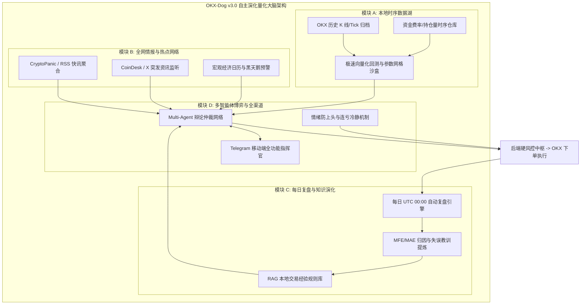
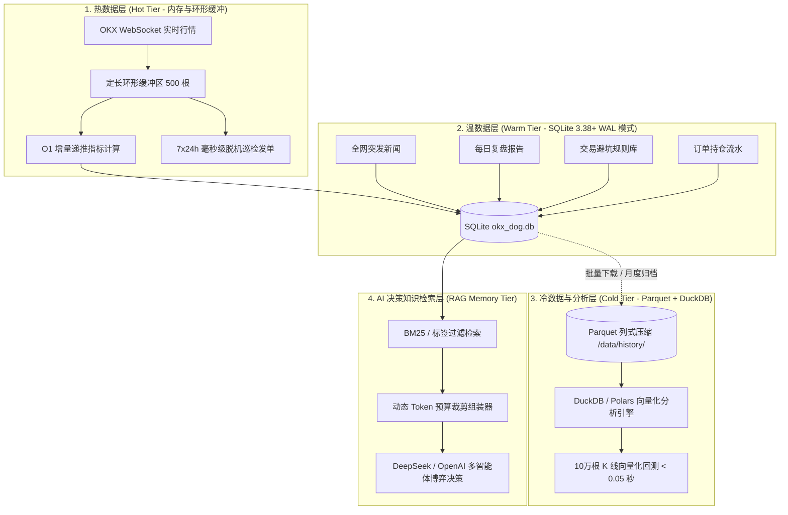
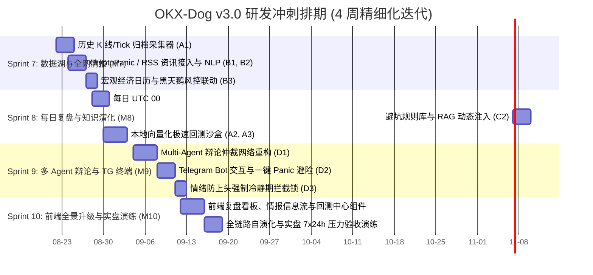

# OKX-Dog v3.0 个人智能量化操作系统与自主演化交易大脑
# 生产级产品需求规格说明书 (Product Requirements Document - PRD v3.0)

| 文档版本 | 编写日期 | 状态 | 适用角色 | 核心模块 |
| :--- | :--- | :--- | :--- | :--- |
| **v3.0.0 (Evolution)** | 2026-08-21 | 方案已锁定 / 研发实施基准 | 产品总监 / 资深量化架构师 / AI 工程师 / 全端开发团队 | `okx-dog-product`, `backend`, `ai`, `frontend` |

---

## 1. 业务背景与问题陈述 (Problem Statement & Vision)

### 1.1 现状与痛点剖析
当前 OKX-Dog 系统（v2.0）已建立高可用的单机交易副驾驶闭环（AES-256 密盒、OKX v5 WebSocket/REST 网关、硬风控拦截中枢、React 18 暗黑终端与 7x24h 脱机常驻操盘协程）。

然而，面对真实加密与金融市场，系统仍存在四大关键断点：
1. **历史数据与分析断层 (Lack of Historical Data Lake & Analysis)**：
   - 系统仅依赖内存环形缓冲区维护短时 K 线，缺乏海量历史 Tick/K 线、资金费率、持仓量 (OI) 的持久化归档与清洗能力，无法进行严谨的策略回测、参数网格优化与历史统计归因。
2. **市场情报孤岛与热点盲区 (Intelligence Blindspot)**：
   - 现存系统仅看技术指标（K线、均线、RSI），无法感知全网突发新闻、宏观经济事件（如非农/CPI/美联储利率决议）、行业突发监管、巨鲸大额异动等，容易在黑天鹅事件中被动承受冲击。
3. **缺乏每日复盘与自演化知识沉淀 (Lack of Daily Post-Mortem & Memory Graph)**：
   - 资深交易员的核心竞争力在于“每日深度复盘与经验复用”。系统目前不会从过往的止损交易中提取教训，无法自动生成每日盘后总结，缺乏将“历史错误”沉淀为“决策避坑规则”的知识库闭环。
4. **移动端触达缺失与情绪防护不足 (Lack of Mobile Sync & Tilt Control)**：
   - 离开电脑桌面后无法通过移动端（Telegram）干预系统；连续亏损时缺乏强制冷却机制，难以抵御主观交易中的“上头/复仇交易”。

### 1.2 系统愿景 (Vision 3.0)
**将 OKX-Dog 从「单机交易终端」全面升维为「全资产、多智能体协同、具备自学习与知识演化能力的本地量化交易大脑 (Autonomous Quant OS & Self-Evolving Brain)」**。
构建：**本地时序数据湖 + 全网宏观情报网络 + 每日复盘与知识演化 + 多智能体对抗决策 + 全渠道移动端协同** 五位一体的工业级可持续量化体系。

---

## 2. 核心目标与量化成功指标 (Goals & Success Metrics)

| 目标分类 | 核心目标 (Goal) | 量化指标 (Key Metric) | 现状基线 | v3.0 交付目标 | 衡量周期 |
| :--- | :--- | :--- | :--- | :--- | :--- |
| **数据与回测** | 建立全自动历史行情归档与高精度回测 | 历史数据覆盖度与回测速度 | 0 (仅短时内存) | 覆盖 6+ 核心标的 2 年 15m/1h 数据，10,000 根 K 线回测 < 3 秒 | 上线 30 天 |
| **情报感知** | 全网突发新闻与宏观事件毫秒级捕获 | 突发异动/宏观事件响应延迟 | 0 (无资讯感知) | 突发新闻捕获并完成 AI 情感打分 < 30 秒，宏观日历 100% 自动对齐 | 上线 14 天 |
| **复盘演化** | 每日全自动深度复盘与经验知识库沉淀 | 每日复盘完成率与避坑召回率 | 0 (无复盘) | 每日 UTC 00:00 复盘报告生成率 100%，历史失误规则库注入决策命中率 > 85% | 上线 30 天 |
| **决策胜率** | 多 Agent 博弈决策与移动保本过滤假突破 | 策略盈亏比 (RR) 与月度胜率 | 胜率 ~52%, RR 1:1.3 | **胜率 $\ge 62\%$，平均盈亏比 $\ge 1:1.8$，最大回撤 $\le 8\%$** | 季度统计 |
| **全渠道协同** | Telegram 移动端全天候双向指令与推流 | 告警推流延迟与一键平仓耗时 | 无移动端 | **TG 告警推送 < 500ms，移动端 Panic 平仓耗时 < 300ms** | 上线首日 |
| **心理风控** | 连续亏损情绪防上头与强制冷却锁 | 冲动复仇交易拦截率 | 依赖人工自律 | **连续 2 笔止损触发 60min 强制冷却阻断率 100%** | 上线首日 |

---

## 3. 非目标与安全红线 (Non-Goals & Anti-Features)

1. **绝对禁止云端中心化密钥托管**：所有 API 密钥、数据库、新闻缓存、交易复盘知识库均 100% 运行并落盘在交易员本地机器，绝不建立任何第三方 SaaS 中转服务器。
2. **绝对禁止开通提现接口权限**：系统从代码与协议层面彻底物理隔离 `withdraw` 权限。
3. **不做未经回测验证的黑盒高频做市 (HFT)**：系统专注于基于高确定性多周期趋势、微观异动与宏观共振的中高胜率波段与日内量化。
4. **不做重度社交炒币社区**：保持交易员个人终极武器的纯粹性，杜绝噪音。

---

## 4. 资深交易员业务全旅程演进 (End-to-End User Journey 3.0)

```mermaid
journey
    title 资深交易员的一天 (OKX-Dog v3.0 自主演化日常)
    section 1. 盘前准备 (08:00 UTC)
      自动获取全网要闻与宏观经济日历: 5: 系统自动
      生成《每日早报与宏观态势简报》推送到 Telegram: 5: 系统自动
      交易员手机端一览多空情绪与今日风险事件: 4: 交易员
    section 2. 盘中巡检与博弈决策 (09:00 - 23:00)
      多标的池轮巡与时序数据湖持续落盘: 5: 系统自动
      多智能体对抗辩论 (多头 vs 空头 vs 盘口 vs 宏观): 5: 系统自动
      Telegram / Web 端推送高胜率决策卡片: 5: 系统自动
      一键采纳 / 自动开仓附带 OCO 止盈止损: 5: 交易员/AutoPilot
      浮盈达标自动移动保本 (Breakeven Locked): 5: 系统自动
      连亏触发防上头冷却锁，强制冷静: 5: 系统自动
    section 3. 盘后深度复盘与自我演化 (00:00 UTC)
      全量计算当日交易 MFE/MAE 收益归因: 5: 系统自动
      生成《每日盘后复盘报告》提炼失误教训: 5: 系统自动
      更新《交易员知识库与避坑规则库》: 5: 系统自动
      策略自适应微调参数权重用于明日实战: 5: 系统自动
```

---

## 5. 四大核心模块详细功能规格 (Functional Specifications)



---

### 模块 A：本地多维时序数据湖与历史归档引擎 (Market Data Lake & Historical Engine)

#### 1. 业务目标
为系统提供沉淀历史行情资产、进行离线大数据分析与高精度策略回测的底层基础设施。

#### 2. 功能详细设计
- **A1. 历史行情多周期自动采集与落库 (Data Collector)**：
  - 支持后台自动或一键拉取指定标的（BTC, ETH, SOL, XAU, NVDA, TSLA, ONDO）最近 1~3 年的 15m, 1h, 4h, 1d 历史 K 线。
  - 数据持久化采用 **SQLite WAL 分区表 + 本地 Parquet/CSV 压缩归档**，支持断点续传与增量对齐。
  - 同步采集历史资金费率 (Funding Rate)、未平仓合约量 (OI)、全网多空人数比，构建多维历史特征库。
- **A2. 本地极速向量化回测沙盒 (Vectorized Backtest Engine)**：
  - 基于 NumPy/Pandas 构建极速回测框架，10,000 根 K 线回测完成时间 $< 3$ 秒。
  - **强制包含现实摩擦模型**：Taker 手续费 (0.05%)、Maker 手续费 (0.02%)、保守滑点模型 (0.05%~0.2%)、资金费率扣除。
  - 输出指标：总收益率、年化收益率、最大回撤 (Max Drawdown)、夏普比率 (Sharpe Ratio)、卡尔玛比率 (Calmar Ratio)、胜率、盈亏比分布、MFE/MAE 散点图。
- **A3. 参数网格与 Walk-Forward 自适应优化 (Strategy Optimizer)**：
  - 支持移动保本触发比例（0.3R ~ 1.0R）、动态止损 ATR 乘数（1.5 ~ 3.0）、均线周期的参数网格搜索。
  - 采用 Walk-Forward 滚动窗口验证，严防“样本内过拟合”。

---

### 模块 B：全网宏观情报与热点新闻感知网络 (Market Intelligence & News Ingestion Engine)

#### 1. 业务目标
让系统具备资深交易员的“眼观六路”能力，实时感知全球金融动态与突发热点，规避黑天鹅，捕捉事件驱动型机会。

#### 2. 功能详细设计
- **B1. 多源财经与加密资讯自动聚合 (Multi-Source Ingestion)**：
  - 接入 **CryptoPanic API**（全球加密新闻聚合）、**RSS 财经快讯源**（Reuters/Bloomberg 加密专栏、CoinDesk、CoinTelegraph）。
  - 内置**全球宏观经济日历**（美联储 FOMC 利率决议、美国 CPI/PPI 公布、非农就业数据 NFP、失业率）。
- **B2. AI 突发新闻事件结构化解析与情感打分 (News NLP & Sentiment Engine)**：
  - 采用轻量 LLM 在 3 秒内对流入新闻完成结构化提取：
    - `sentiment_score`: -1.0 (极度利空) ~ +1.0 (极度利好)
    - `urgency`: P0 (突发黑天鹅/极端利好) / P1 (重要) / P2 (一般资讯)
    - `related_symbols`: 关联币种列表（如 `["BTC", "ETH"]`）
    - `is_fud_or_rumor`: 谣言/未经证实消息识别标志
    - `summary_zh`: 中文极简一句话核心提炼
- **B3. 宏观事件风控联动与预警降级 (Macro Risk Guard)**：
  - 在重大宏观数据（如 CPI / FOMC）公布前 **15 分钟**，系统自动向 Telegram/前端发出高危预警。
  - Auto-Pilot 自动收紧开仓杠杆（降至 2x），或自动将止损线移至最近支撑阻力位，防止插针爆仓。

---

### 模块 C：每日自动复盘与知识演化大脑 (Daily Post-Mortem & Memory Graph)

#### 1. 业务目标
解决“系统不长记性、重复犯错”的问题，让 OKX-Dog 每天自动复盘总结，提炼教训并沉淀为长期交易规则库，实现策略的自我演化。

#### 2. 功能详细设计
- **C1. 每日全自动定时复盘报告 (Daily Post-Mortem Generator)**：
  - **触发时机**：每日 UTC 00:05（或用户自定义时间）自动触发。
  - **复盘维度**：
    1. **当日战报统计**：总交易笔数、胜率、实现盈亏、最大浮亏/浮盈、手续费磨损。
    2. **交易逐笔解剖**：AI 重新审视每一笔平仓订单的开仓理由、入场价位、出场时机是否符合纪律。
    3. **MFE / MAE 效率评估**：分析是否存在“过早止盈卖飞”或“未能及时保本导致盈利变亏损”。
    4. **得失归因与教训提炼**：输出 3 条今日做得最好的操作，以及 3 条今日最大教训。
- **C2. 交易经验与避坑规则知识库 (RAG Knowledge Base)**：
  - 将每日提炼的教训格式化为规则条目存入本地 `trading_knowledge_base` 表（如：`"在资金费率 > 0.08% 且 RSI 处于 4H 顶背离时坚决不做多"`）。
  - **反向避坑注入 (Negative Few-Shot Injection)**：当盘中 Multi-Agent 重新研判时，系统自动通过关键词/语义检索出相关的历史失误规则，作为**“前车之鉴警示词”**动态注入 Prompt，直接阻断同类错误再次发生！
- **C3. 策略权重自适应调节机制 (Dynamic Strategy Allocation)**：
  - 根据最近 7 天的实盘/模拟盘表现，动态提升高胜率策略的分配额度，自动削减震荡磨损策略的资金权重。

---

### 模块 D：多智能体对抗辩论中枢与全渠道协同 (Multi-Agent Consensus & Telegram Bot)

#### 1. 业务目标
消除单模型幻觉，建立多角色对抗博弈机制，并通过 Telegram 赋予交易员全天候移动端掌控力。

#### 2. 功能详细设计
- **D1. 多智能体博弈决策网络 (Multi-Agent Consensus Network)**：
  - **多头辩护专家 (Bull Specialist Agent)**：负责寻找形态突破、均线金叉、多头主力资金流入等买入逻辑。
  - **空头风控专家 (Bear Critic Agent)**：负责挑刺，寻找上方密集套牢盘、顶背离、大单抛压、资金费率过热等看空风险。
  - **宏观与舆情专家 (Macro & News Agent)**：结合即时新闻与宏观日历，评估整体大盘风险偏好。
  - **首席量化仲裁官 (Chief Arbiter Agent)**：综合各 Agent 辩论陈述与历史避坑知识库，计算最终共识分 (`consensus_score` 0~100)。只有共识分 $\ge 75$ 且盈亏比 $\ge 1:1.8$ 时方可签发交易指令。
- **D2. Telegram 移动端全功能指挥官 (Telegram Co-pilot Bot)**：
  - **无缝通知**：开仓/平仓/移动保本/风控熔断/每日复盘报告图文毫秒级推送。
  - **快捷交互指令**：
    - `/report`：获取今日最新盘后复盘战报与收益曲线图。
    - `/news`：查看最新 5 条重大市场宏观与突发情报。
    - `/status`：查看当前账户净值、未平仓持仓浮盈及 Auto-Pilot 运行状态。
    - `/panic`：一键紧急避险市价全平（带二次确认按钮）。
    - `/adopt <id>`：远程快速确认执行半自动策略。
- **D3. 交易心理防上头与强制冷却锁 (Tilt Protection Guard)**：
  - **连亏熔断冷却**：2 小时内连续触发 2 笔止损单，系统自动锁定 60 分钟（禁止任何开仓，只允许平仓）。
  - **降杠杆惩罚**：单日出现亏损时，系统强制下调最大可用杠杆至 2x，单笔开仓限额减半。

---

## 6. 存储落地实现与大数据降维架构 (Storage Implementation & Big Data Optimization)

针对用户对“海量历史数据存储会不会导致性能卡顿与分析爆炸”的顾虑，系统确立 **“冷热分层 + 列式压缩 + 动态 Token 预算”** 混合存储架构规范：



### 6.1 数据量测算与无膨胀保证
- **中低频 K 线（15m/1h/4h/1d）**：10 个核心标的 3 年数据总量仅约 150 万行，SQLite 占用 **$< 150\text{ MB}$**，Parquet 压缩后仅 **$< 30\text{ MB}$**，Polars/Pandas 内存加载耗时 $< 20\text{ms}$。
- **杜绝高频 Tick 洪水**：严禁在单机持久化原始毫秒级 Raw Ticks。仅在内存中计算 1 分钟/15 分钟聚合特征（如 VWAP、资金费率、大单买卖比）后落盘。

### 6.2 存储分层落地矩阵

| 存储层级 | 介质选型 | 读写延迟 | 空间占用 | 核心承载数据 |
| :--- | :--- | :--- | :--- | :--- |
| **热层 (Hot Tier)** | 内存 `collections.deque(maxlen=500)` | **$< 0.1\text{ ms}$** | $< 10\text{ MB}$ | 实时 5 档/400 档盘口、多周期当前 K 线、O(1) 递推指标 |
| **温层 (Warm Tier)** | 本地 SQLite (`okx_dog.db`, WAL 模式) | **$< 2\text{ ms}$** | $< 150\text{ MB}$ | 系统配置、加密密盒、订单与持仓、每日复盘、避坑规则库、全网新闻 |
| **冷层 (Cold Tier)** | 列式压缩文件 (`data/history/*.parquet`) | **$< 30\text{ ms}$** | $< 50\text{ MB}$ | 1~3 年全周期历史 K 线、历史资金费率与持仓量时序（用于 DuckDB 极速回测） |
| **AI 记忆层 (RAG Tier)** | SQLite FTS5 / 结构化标签过滤 | **$< 1\text{ ms}$** | $< 5\text{ MB}$ | 历史失误教训规则（用于在研判时作为 Negative Few-Shot 动态注入） |

### 6.3 AI 提示词“动态 Token 预算裁剪”规范
- **P0 必填特征**：当前价格、EMA(20/50/200) 排列、RSI(14)、布林带带宽、资金费率与 OI 异动。
- **P1 支撑阻力**：前高前低水平位、当前持仓成本价与预估强平价。
- **P2 避坑规则**：从 `trading_knowledge_base` 召回当前场景最相关的 **2 条历史亏损教训**。
- **P3 丢弃**：全量历史 K 线逐点列表直接丢弃。
- **效果**：每次 AI 决策输入严格控制在 **800 ~ 1,200 Tokens**，响应极速且零注意力稀释。

---

## 7. 系统数据架构演进与新增数据表设计 (Database Schema v3.0)

在现有 9 张业务表基础上，新增 5 张关键核心表：

```sql
-- 1. 历史 K 线与行情数据湖表 (支持大数据量分区与高频检索)
CREATE TABLE IF NOT EXISTS historical_klines (
    symbol VARCHAR(32) NOT NULL,
    timeframe VARCHAR(8) NOT NULL, -- 15m, 1h, 4h, 1d
    timestamp BIGINT NOT NULL,     -- 毫秒时间戳
    open_price REAL NOT NULL,
    high_price REAL NOT NULL,
    low_price REAL NOT NULL,
    close_price REAL NOT NULL,
    volume REAL NOT NULL,
    funding_rate REAL DEFAULT 0.0,
    open_interest REAL DEFAULT 0.0,
    PRIMARY KEY (symbol, timeframe, timestamp)
);
CREATE INDEX IF NOT EXISTS idx_hist_klines_search ON historical_klines (symbol, timeframe, timestamp DESC);

-- 2. 全网宏观与行业热点资讯表
CREATE TABLE IF NOT EXISTS news_events (
    id VARCHAR(64) PRIMARY KEY,
    source VARCHAR(32) NOT NULL,    -- cryptopanic, rss, coindesk, manual
    title TEXT NOT NULL,
    content TEXT,
    url TEXT,
    published_at BIGINT NOT NULL,
    created_at BIGINT NOT NULL,
    sentiment_score REAL DEFAULT 0.0, -- -1.0 ~ 1.0
    urgency VARCHAR(8) DEFAULT 'P2',  -- P0, P1, P2
    related_symbols TEXT,             -- JSON: ["BTC", "ETH"]
    is_fud_or_rumor INTEGER DEFAULT 0,
    summary_zh TEXT
);
CREATE INDEX IF NOT EXISTS idx_news_published ON news_events (published_at DESC);
CREATE INDEX IF NOT EXISTS idx_news_urgency ON news_events (urgency, published_at DESC);

-- 3. 每日盘后复盘报告表
CREATE TABLE IF NOT EXISTS daily_reviews (
    review_date VARCHAR(10) PRIMARY KEY, -- '2026-08-21'
    created_at BIGINT NOT NULL,
    total_trades INTEGER DEFAULT 0,
    winning_trades INTEGER DEFAULT 0,
    losing_trades INTEGER DEFAULT 0,
    win_rate REAL DEFAULT 0.0,
    realized_pnl REAL DEFAULT 0.0,
    fee_paid REAL DEFAULT 0.0,
    max_drawdown REAL DEFAULT 0.0,
    best_trade_pnl REAL DEFAULT 0.0,
    worst_trade_pnl REAL DEFAULT 0.0,
    summary_markdown TEXT NOT NULL,       -- AI 生成的完整结构化复盘报告
    lessons_learned TEXT,                 -- JSON: ["教训1", "教训2"]
    strategy_adjustments TEXT             -- JSON: 参数调优建议
);

-- 4. 交易员经验与避坑规则知识库 (RAG Knowledge Base)
CREATE TABLE IF NOT EXISTS trading_knowledge_base (
    id VARCHAR(64) PRIMARY KEY,
    rule_type VARCHAR(32) NOT NULL,       -- 'MISTAKE_AVOIDANCE', 'BEST_PRACTICE', 'MACRO_REGIME'
    symbol_scope VARCHAR(32) DEFAULT '*', -- 适用标的，'*' 表示全品类
    trigger_condition TEXT NOT NULL,      -- 触发前置场景描述
    action_rule TEXT NOT NULL,            -- 约束行动准则
    confidence_score REAL DEFAULT 1.0,    -- 规则置信权重
    source_review_date VARCHAR(10),       -- 来源于哪一天的复盘
    times_triggered INTEGER DEFAULT 0,    -- 被命中拦截次数
    is_active INTEGER DEFAULT 1,
    created_at BIGINT NOT NULL,
    updated_at BIGINT NOT NULL
);
CREATE INDEX IF NOT EXISTS idx_kb_type ON trading_knowledge_base (rule_type, is_active);

-- 5. 本地策略回测实验记录表
CREATE TABLE IF NOT EXISTS backtest_experiments (
    id VARCHAR(64) PRIMARY KEY,
    strategy_name VARCHAR(64) NOT NULL,
    symbol VARCHAR(32) NOT NULL,
    timeframe VARCHAR(8) NOT NULL,
    start_time BIGINT NOT NULL,
    end_time BIGINT NOT NULL,
    parameters TEXT NOT NULL,             -- JSON: 回测入参
    total_return_pct REAL NOT NULL,
    sharpe_ratio REAL NOT NULL,
    max_drawdown_pct REAL NOT NULL,
    win_rate REAL NOT NULL,
    profit_factor REAL NOT NULL,
    total_trades INTEGER NOT NULL,
    metrics_detail TEXT NOT NULL,         -- JSON 详尽统计
    created_at BIGINT NOT NULL
);
```

---

## 8. 实施里程碑与迭代排期 (Roadmap & WBS v3.0)



---

## 9. 总结与签署

本 `PRD_V3.md` 作为 OKX-Dog 系统向**工业级、可持续盈利、具备自演化能力的个人量化操作系统**进化的正式规格指导文档。各研发模块将以此为唯一输入源，分步完成数据库迁移、后端多引擎接入、AI 协同编排与前端/移动端体验闭环。
