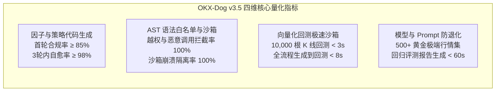
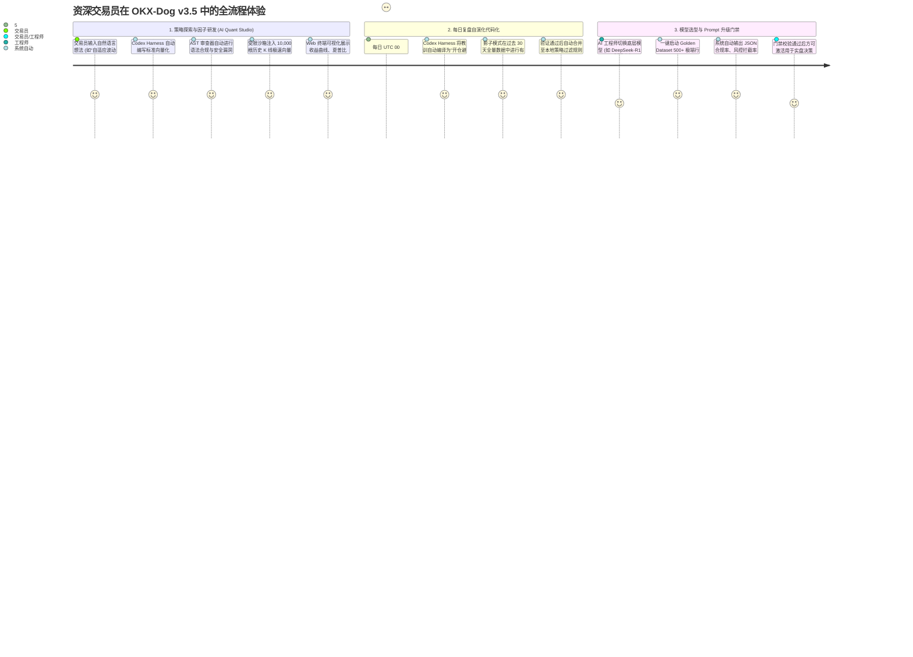
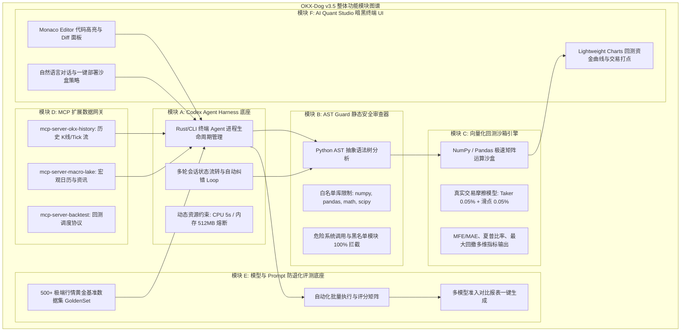
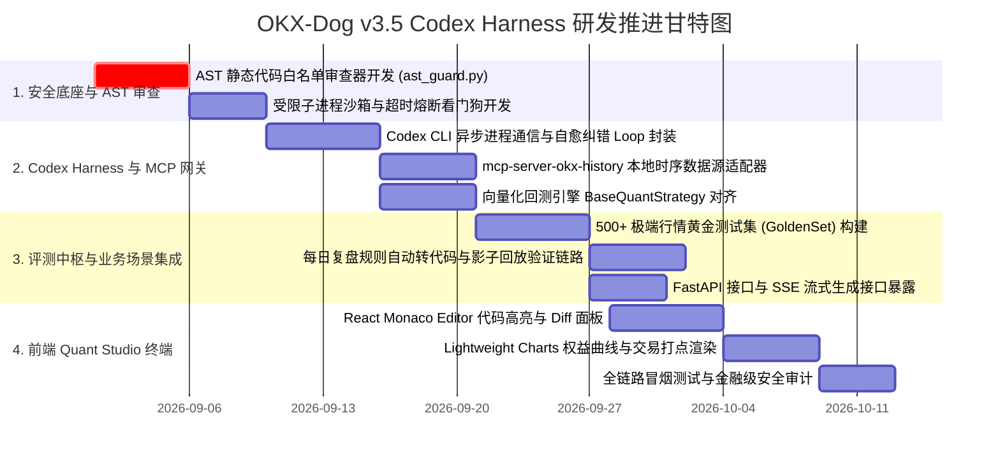

# OKX-Dog v3.5 AI 量化策略实验室与 Codex Harness 智能体沙箱操作系统
# 生产级产品需求规格说明书 (Product Requirements Document - PRD v3.5)

| 文档版本 | 编写日期 | 状态 | 适用角色 | 核心模块 |
| :--- | :--- | :--- | :--- | :--- |
| **v3.5.0 (Codex Studio)** | 2026-08-21 | 方案已锁定 / 研发实施基准 | 产品总监 / 资深量化架构师 / AI 工程师 / 全端开发团队 | `okx-dog-studio`, `backend`, `ai`, `frontend` |

---

## 1. 业务背景与问题陈述 (Problem Statement & Vision)

### 1.1 现状与痛点剖析
在 OKX-Dog v3.0 版本中，系统已构建了本地时序数据湖、全网宏观情报网络、每日 UTC 00:00 自动复盘与 LangGraph 多智能体对抗决策。然而，随着交易员对高阶 Alpha 因子与个性化量化策略的需求升级，系统暴露了三项关键技术与产品断点：

1. **量化策略逻辑表达僵化 (Rigid Strategy Expression)**：
   - 现有系统依赖预编译的 8 大经典技术指标（EMA/MACD/RSI/布林带/ATR/FR/OI/盘口深度），AI 仅能在既定指标上做权重仲裁与 JSON 参数推导。无法让 AI 自主探索高阶数学因子（如 Hurst 指数自适应通道、高频微观结构订单流不平衡量、跨期资金费率套利公式）。
2. **复盘经验与避坑规则无法自动代码化 (Manual Knowledge Translation Gap)**：
   - 每日复盘提炼的自然语言规则（如“高资金费率下突破前高 80% 为假突破”）停留在 Prompt 文本注入层面，缺乏将自然语言自动编译为高性能 Python 过滤逻辑并进行高精度历史验证的代码化闭环。
3. **模型与 Prompt 升级缺乏确定性评估底座 (Lack of Offline Eval & Regression Harness)**：
   - 当微调 System Prompt、切换底层大模型（如从 DeepSeek 切换至 Claude 3.5 Sonnet / GPT-4o）或更新 Few-Shot 样本时，缺乏标准化的黄金测试集（Golden Dataset）进行自动化批量评测与防退化拦截。

### 1.2 解决方案与愿景 (Vision 3.5)
**基于 OpenAI 开源的终端级 Agent 执行底座 `openai/codex`，构建 OKX-Dog AI Quant Studio（AI 量化策略代码实验室与沙箱操作系统）**。

在严格保证**实盘毫秒级交易热路径（Live Hot Path）物理隔离**的前提下，引入 Codex Harness 作为离线/温路径的独立底座，赋予系统**“自主生成 Python 因子代码 -> AST 语法与越权安全拦截 -> 受限沙箱极速回测 -> 经验自动代码化 -> 模型升级防退化基准评测”**的完整自演化量化操作系统。

---

## 2. 核心目标与量化成功指标 (Goals & Success Metrics)



| 目标分类 | 核心目标 (Goal) | 量化指标 (Key Metric) | 现状基线 (v3.0) | v3.5 交付目标 | 衡量周期 |
| :--- | :--- | :--- | :--- | :--- | :--- |
| **代码生成** | 自然语言生成标准 Python 因子与策略脚本 | 语法合规率 & 自动纠错自愈率 | 0 (依赖人工手写) | **首轮通过率 $\ge 85\%$，3轮内自愈率 $\ge 98\%$** | 上线 14 天 |
| **沙箱安全** | 本地代码沙箱隔离执行与越权防护 | 危险调用拦截率 & 资源超限熔断率 | 无沙箱 | **危险调用拦截率 $100\%$，内存超限熔断率 $100\%$** | 上线首日 |
| **回测效率** | 历史数据湖无缝注入与向量化回测 | 10,000 根 K 线策略回测计算耗时 | 0 (无动态代码回测) | **回测耗时 $\le 3$ 秒，全流程端到端 $\le 8$ 秒** | 上线 14 天 |
| **经验代码化** | 每日复盘避坑规则自动转化为过滤代码 | 规则代码化成功率与影子回放命中率 | 0 (仅纯文本注入) | **规则代码化率 $\ge 90\%$，历史止损过滤有效性 $> 80\%$** | 上线 30 天 |
| **模型治理** | Prompt 与底层模型升级回归测试底座 | 黄金测试集评测覆盖度与报告耗时 | 依赖人工抽检 | **覆盖 500+ 极端行情样本，自动化评测报告 $\le 60$ 秒** | 上线 30 天 |

---

## 3. 非目标与安全红线 (Non-Goals & Financial Security Redlines)

> [!CAUTION]
> **金融级系统核心红线：严守资金安全与执行隔离，任何开发角色严禁越界：**

1. **绝对禁止侵入实盘交易热路径 (No Hot-Path Intrusion)**：
   - Codex Harness 与动态 Python 代码执行**严禁置于 WebSocket 毫秒级买卖报单链路上**。实盘执行层只运行经过静态审计、预编译且通过硬风控中枢的确定性逻辑。
2. **绝对禁止提现、转账与外网随意外联 (Physical Permission Isolation)**：
   - 沙箱执行环境完全剥离一切 OKX 资金调拨权限与 API Secret 访问权限，严禁沙箱内代码直接发起非白名单的网络请求。
3. **沙箱文件与密钥物理隔离 (Zero Credential Exposure)**：
   - 沙箱工作区限定在 `okx-dog-ai/studio/workspace/` 独立目录中；严禁沙箱代码读取宿主环境 `.env`、加密密盒文件或上级敏感目录。

---

## 4. 资深交易员端到端业务旅程 (End-to-End User Journey v3.5)



---

## 5. 六大核心功能模块详细技术规格 (Functional Specifications)



---

### 模块 A：Codex Agent Harness 本地执行中枢 (`okx-dog-studio/harness`)

#### 1. 功能目标
基于 `openai/codex` 封装异步 Python 客户端，负责与底层 Codex CLI / Agent 进程进行安全长连接通信、任务调度、多轮代码自愈纠错与超时熔断控制。

#### 2. 核心详细设计
- **A1. 进程生命周期与单例连接池**：
  - 封装 `CodexHarnessManager`，采用 AsyncIO 异步子进程模式与本地 Codex 交互。
  - 严格限制并发执行数（默认并发度 $\le 2$），防止大并发沙箱压测耗尽本地 CPU 资源。
- **A2. 自愈纠错闭环 (Self-Healing Loop)**：
  - 当代码在 AST 审查或沙箱执行阶段抛出语法错误（`SyntaxError`）或运行时异常（`IndexError`, `KeyError`）时，Harness 自动捕获 Traceback 并反哺给 Codex 进行针对性修复，重试上限为 3 次。
- **A3. 严格资源配额与看门狗 (Watchdog Timeout)**：
  - 单次代码执行超时上限：$5,000\text{ ms}$（超时自动发送 `SIGKILL`）。
  - 最大允许内存驻留：$512\text{ MB}$。

---

### 模块 B：AST Guard 静态代码安全审查器 (`okx-dog-studio/security`)

#### 1. 功能目标
在任何 AI 生成的 Python 代码进入沙箱执行前，通过 AST 抽象语法树进行静态安全审计，彻底杜绝恶意代码、死循环或敏感资源窃取。

#### 2. 核心详细设计
- **B1. 白名单导入机制 (Import Whitelist)**：
  - 仅允许导入数据分析与数学计算库：`numpy`, `pandas`, `math`, `scipy`, `typing`, `dataclasses`。
  - 严禁导入一切系统级与网络库：`os`, `sys`, `subprocess`, `socket`, `requests`, `urllib`, `shutil`, `ctypes`, `builtins`。
- **B2. 危险函数调用阻断 (Call Blocklist)**：
  - 严禁调用内置破坏性函数：`eval()`, `exec()`, `compile()`, `open()`, `__import__()`, `getattr()`, `setattr()`, `globals()`, `locals()`。
- **B3. 静态复杂度与无限循环检测**：
  - 禁止无条件的 `while True:` 结构（必须包含显式边界变量），限制嵌套循环层数 $\le 3$。

---

### 模块 C：本地极速向量化回测沙箱 (`okx-dog-studio/sandbox`)

#### 1. 功能目标
为 AI 生成的策略代码提供标准运行环境，自动注入历史 K 线与衍生品时序数据，以向量化方式极速评估策略在历史行情中的真实表现。

#### 2. 核心详细设计
- **C1. 标准策略基类契约 (`BaseQuantStrategy`)**：
  - 要求所有生成的策略必须实现标准接口：
    ```python
    class BaseQuantStrategy(ABC):
        @abstractmethod
        def generate_signals(self, df: pd.DataFrame) -> pd.Series:
            """
            输入包含 [open, high, low, close, volume, funding_rate, oi] 的历史 DataFrame
            返回包含 1 (开多), -1 (开空), 0 (平仓/观望) 的信号 Series
            """
            pass
    ```
- **C2. 真实摩擦模型集成 (Friction Model)**：
  - 强制扣除手续费：Taker $0.05\%$、Maker $0.02\%$。
  - 强制计入保守滑点：$0.05\%\sim 0.15\%$。
  - 资金费率结算：按 8h 周期动态扣除/赚取资金费用。
- **C3. 专业量化评估指标输出**：
  - 输出：总收益率 (Total Return)、年化收益 (CAGR)、最大回撤 (Max Drawdown)、夏普比率 (Sharpe Ratio)、卡尔玛比率 (Calmar Ratio)、胜率 (Win Rate)、盈亏比 (Profit/Loss Ratio)、MFE/MAE 散点分布。

---

### 模块 D：基于 MCP 的数据与工具扩展网关 (`okx-dog-studio/mcp`)

#### 1. 功能目标
通过标准 Model Context Protocol (MCP)，将 OKX-Dog 的本地历史数据湖与工具库无缝暴露给 Codex Harness，实现即插即用。

#### 2. 核心详细设计
- **D1. `mcp-server-okx-history`**：
  - 向 Codex 提供 `get_historical_klines(symbol, timeframe, start_date, end_date)` 工具，高效读取本地 Parquet/SQLite WAL 数据。
- **D2. `mcp-server-macro-lake`**：
  - 提供 `query_macro_calendar()` 及 `search_historical_news(keyword, date_range)` 工具，支持因子结合宏观事件。
- **D3. `mcp-server-backtest-runner`**：
  - 提供 `execute_backtest(strategy_code, symbol, timeframe)` 工具，由 Harness 调度执行并返回结构化性能指标。

---

### 模块 E：模型与 Prompt 防退化评测底座 (`okx-dog-studio/benchmark`)

#### 1. 功能目标
构建工业级的 AI 决策防退化门禁，确保任何 Prompt 调整或底层模型切换前，均通过 500+ 极端行情黄金数据集的自动化压力测试。

#### 2. 核心详细设计
- **E1. 黄金测试集体系 (Golden Dataset - 500+ Snapshots)**：
  - 涵盖 5 大极端行情场景：
    1. **极端单边暴跌插针 (Crash & Wick, 100 组)**：如 312、FTX 暴雷等流动性枯竭行情。
    2. **超高资金费率极端轧空 (Short Squeeze & FR Spikes, 100 组)**：资金费率 $> 0.05\%$ 的极端多空博弈。
    3. **窄幅横盘假突破诱多 (Fake Breakout & Choppy, 100 组)**：高频洗盘与均线粘合震荡。
    4. **宏观重磅数据公布 (Macro Shock - CPI/NFP/FOMC, 100 组)**：剧烈双向波动行情。
    5. **常规健康趋势行情 (Healthy Trend, 100 组)**：标准均线多头/空头排列。
- **E2. 自动化基准评估与对比矩阵**：
  - 输出格式契约达成率（JSON Schema 100% 合规）、止损设置合规率、风险警示识别率、策略预期盈亏比对比。

---

### 模块 F：前端 AI Quant Studio 策略实验室 UI (`okx-dog-frontend`)

#### 1. 功能目标
在 React 18 金融级暗黑终端中提供直观、专业的策略代码编写、回测结果可视化与一键部署交互界面。

#### 2. 核心详细设计
- **F1. 双栏代码与对话布局 (Studio Workspace Layout)**：
  - 左侧：AI 交互对话框（自然语言输入策略诉求、参数微调、思维链日志）。
  - 右侧：集成 **Monaco Editor**（只读/编辑 Python 策略代码，支持语法高亮与版本 Diff 对比）。
- **F2. Lightweight Charts 回测可视化看板**：
  - 主图：K 线走势与 AI 策略的开多（绿色箭头）、开空（红色箭头）、移动保本平仓标记点。
  - 副图 1：账户资金权益曲线（Equity Curve）对比基准买入持有（Buy & Hold）。
  - 副图 2：回撤水位图（Drawdown Underwater Chart）。
- **F3. 一键部署与沙箱测试切换**：
  - 支持一键将验证通过的策略保存至本地策略库，或以“观察者模式 (Observer/Shadow Mode)”挂载至模拟盘。

---

## 6. 数据契约与接口规格设计 (API Specifications)

### 6.1 后端 Pydantic 核心数据模型契约

```python
# 模块: okx-dog-studio/schemas.py

from enum import Enum
from typing import Any, Dict, List, Optional
from pydantic import BaseModel, Field


class StrategyStatus(str, Enum):
    DRAFT = "DRAFT"
    VERIFIED = "VERIFIED"
    FAILED = "FAILED"
    ACTIVE = "ACTIVE"


class GenerateStrategyRequest(BaseModel):
    """交易员生成量化策略请求"""
    prompt: str = Field(..., description="交易员自然语言策略描述", example="15m RSI超卖且资金费率转正时开多")
    target_symbols: List[str] = Field(default=["BTC-USDT-SWAP"], description="目标回测标的")
    timeframe: str = Field(default="15m", description="回测周期", example="15m")
    backtest_days: int = Field(default=90, ge=7, le=730, description="回测历史天数")
    initial_balance_usdt: float = Field(default=10000.0, description="初始回测资金")


class BacktestMetrics(BaseModel):
    """向量化回测性能指标"""
    total_return_pct: float = Field(..., description="累计收益率 (%)")
    annualized_return_pct: float = Field(..., description="年化收益率 (%)")
    max_drawdown_pct: float = Field(..., description="最大回撤 (%)")
    sharpe_ratio: float = Field(..., description="夏普比率")
    calmar_ratio: float = Field(..., description="卡尔玛比率")
    win_rate_pct: float = Field(..., description="胜率 (%)")
    profit_factor: float = Field(..., description="盈亏比")
    total_trades: int = Field(..., description="总交易笔数")
    avg_trade_duration_bars: float = Field(..., description="平均持仓 K线数")


class TradeSignalPoint(BaseModel):
    """回测开平仓打点数据"""
    timestamp: int = Field(..., description="毫秒时间戳")
    action: str = Field(..., description="BUY / SELL / CLOSE")
    price: float = Field(..., description="成交价格")
    pnl_pct: Optional[float] = Field(None, description="平仓收益率 (%)")


class StrategyExecutionResult(BaseModel):
    """策略生成与沙盒回测最终响应"""
    strategy_id: str = Field(..., description="策略唯一 UUID")
    strategy_name: str = Field(..., description="策略名称")
    code: str = Field(..., description="合规的 Python 向量化策略源码")
    ast_passed: bool = Field(..., description="AST 安全审查是否通过")
    status: StrategyStatus = Field(..., description="策略状态")
    metrics: Optional[BacktestMetrics] = Field(None, description="回测表现")
    equity_curve: List[Dict[str, Any]] = Field(default_factory=list, description="资金权益时序序列")
    trade_signals: List[TradeSignalPoint] = Field(default_factory=list, description="打点列表")
    error_message: Optional[str] = Field(None, description="执行或审查失败信息")
    created_at_ms: int = Field(..., description="创建毫秒时间戳")
```

---

## 7. 跨角色工作任务拆解 (WBS Task Breakdown by Agency Roles)



### 任务认领清单 (Detailed Role Assignments):

#### 1. 后端与安全架构师 (`agency-backend-architect`, `agency-blockchain-security-auditor`)
- [ ] **Task B1**: 编写 `okx-dog-ai/studio/ast_guard.py`，实现 Python AST 白名单机制，100% 拦截系统命令与危险调用。
- [ ] **Task B2**: 编写 `okx-dog-ai/studio/sandbox_runner.py`，封装受限子进程运行器，配置 CPU $5\text{s}$ 与内存 $512\text{MB}$ 强制熔断。
- [ ] **Task B3**: 基于 FastMCP 框架开发 `mcp-server-okx-history`，向 Codex 提供本地 Parquet 极速分块读取能力。
- [ ] **Task B4**: 暴露 FastAPI REST 路由 `/api/v1/studio/generate-strategy` 与 `/api/v1/studio/backtest`。

#### 2. AI 与量化算法工程师 (`agency-ai-engineer`, `agency-prompt-engineer`)
- [ ] **Task A1**: 编写 `okx-dog-ai/studio/prompts/codex_quant_system.md`，定义标准输入输出规范与 Few-Shot 向量化代码范例。
- [ ] **Task A2**: 封装 `CodexHarnessClient`，实现 `Prompt -> Code -> AST -> Run -> Auto-Fix` 的 3 轮自愈闭环。
- [ ] **Task A3**: 整理收录 500+ 极端行情快照，构建 `okx-dog-ai/benchmark/golden_dataset.parquet`。
- [ ] **Task A4**: 实现 `okx-dog-ai/benchmark/eval_runner.py` 自动化评测与模型对比矩阵生成器。

#### 3. 前端资深开发与数据可视化工程师 (`agency-senior-developer`, `agency-data-visualization-engineer`)
- [ ] **Task F1**: 在 Web 终端左侧导航栏新增 **「AI 策略实验室 (Quant Studio)」** 路由与暗黑主题面板。
- [ ] **Task F2**: 集成 `@monaco-editor/react`，实现策略代码高亮、行号展示、格式化与 Diff 对比。
- [ ] **Task F3**: 基于 `Lightweight Charts` 渲染多周期 K 线、回测开平仓打点与权益曲线（Equity Curve）。
- [ ] **Task F4**: 使用 Zustand 实现策略生成、回测进度与代码状态的分片管理。

---

## 8. 发布计划与回滚预案 (Launch Plan & Rollback Runbook)

### 8.1 发布阶段演进
1. **Phase 1: 离线研发与沙箱验证 (Day 1 - 10)**：仅在开发与测试环境中开启 Codex Harness 与 AST 审查，跑通 500 组基准回测。
2. **Phase 2: 影子模式挂载 (Day 11 - 20)**：在实盘后台以 Shadow Mode 运行 AI 生成的过滤规则，统计误杀率与收益提升。
3. **Phase 3: Web 终端全面 GA (Day 21+)**：面向交易员开放自然语言策略生成与可视化回测面板。

### 8.2 紧急熔断与回滚预案 (Emergency Rollback)
- **触发条件**：
  1. AST 审查器出现漏判或沙箱进程占用宿主机 CPU $> 80\%$ 持续超过 10 秒；
  2. 出现任何非预期的外网网络调用尝试。
- **回滚操作**：
  1. 一键关闭后端配置开关 `ENABLE_CODEX_STUDIO=false`；
  2. 系统即刻降级至 v3.0 静态指标决策模式，实盘热路径不受任何影响。

---

## 9. 附录与术语表 (Appendix & Glossary)

- **Codex Harness**：基于 OpenAI Codex 开源底座构建的 Agent 执行框架与代码沙箱支架。
- **AST (Abstract Syntax Tree)**：Python 抽象语法树，用于在代码运行前静态审查语法结构与安全合规性。
- **MCP (Model Context Protocol)**：Anthropic/开源社区通用的模型上下文协议，用于标准化 Agent 工具与数据调用。
- **MFE / MAE**：Maximum Favorable / Adverse Excursion（最大有利/不利偏移量），用于衡量订单入场时机精度。
- **Live Hot Path**：实盘毫秒级交易决策与报单热路径，严禁任何不可控动态代码侵入。
