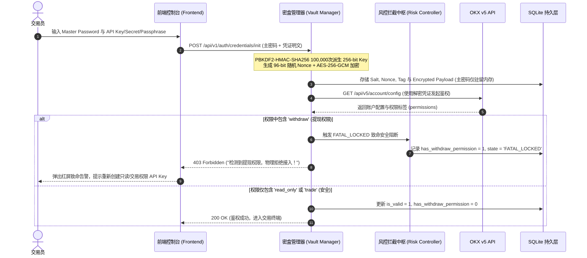
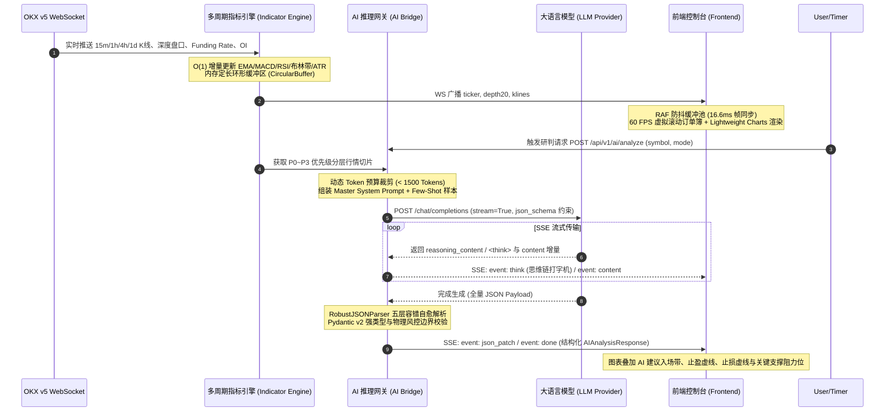
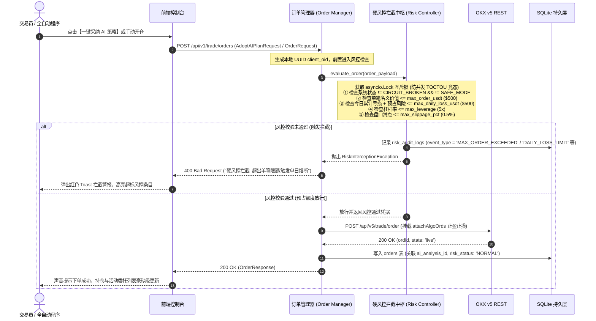
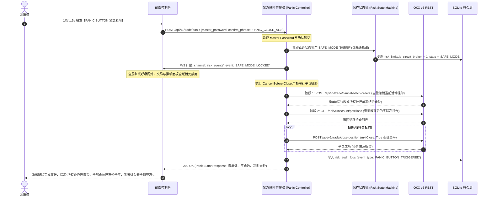

# Project: OKX-Dog 个人智能加密交易副驾驶系统 (AI Trading Co-pilot Terminal)

## 1. 顶层架构全景 (System Architecture Overview)

OKX-Dog 是一套面向个人量化交易者与高阶交易员的**本地私有化智能加密交易副驾驶系统**。系统深度整合 OKX v5 API 毫秒级行情/交易通道与大语言模型（LLM）多周期推理能力，通过金融级暗黑交易终端提供“人机协同决策”、“不可绕过的硬风控拦截”与“毫秒级紧急避险（Panic Button）”。

```
                               ┌─────────────────────────────────────────────────────────┐
                               │     OKX-Dog Frontend (React 18 + TS + TailwindCSS)      │
                               │  - 60 FPS Orderbook Virtual Scroll (RAF Throttler)      │
                               │  - Lightweight Charts (Overlay: Positions / SL / TP)    │
                               │  - Sleek Dark Theme + Panic Button Emergency Lock       │
                               └────────────────────────────┬────────────────────────────┘
                                                            │ REST / WebSocket / SSE
                                                            ▼
                               ┌─────────────────────────────────────────────────────────┐
                               │           FastAPI Async High-Concurrency Gateway        │
                               │  - AES-256-GCM Credential Vault (No-Withdraw Isolation) │
                               │  - Token Bucket Rate Limiter (Strict OKX v5 Compliance) │
                               └──────┬─────────────────────┬─────────────────────┬──────┘
                                      │                     │                     │
                                      ▼                     ▼                     ▼
┌───────────────────────────────────────────────┐ ┌───────────────────┐ ┌────────────────────────────────┐
│            Hard Risk Engine (拦截中枢)        │ │  Storage Layer    │ │     AI & Quantitative Pipeline │
│  - 单笔委托硬上限 (max_order_usdt)             │ │  SQLite (WAL 模式)│ │  - O(1) 多周期增量指标引擎     │
│  - 单日亏损熔断硬锁 (max_daily_loss_usdt)      │ │  - 9 核心业务表   │ │  - 动态 Token 预算裁剪 (P0-P3) │
│  - 杠杆率物理硬锁 (max_leverage <= 5x)        │ │  - 19 显式索引    │ │  - OpenAI 标准多模型统一网关   │
│  - 盘口滑点保护 (max_slippage_pct <= 0.5%)     │ │  - 异步连接池     │ │  - RobustJSONParser 5层容错自愈│
│  - Cancel-Before-Close Panic Button 抢占链路 │ │                   │ │  - MFE / MAE 历史胜率归因模型  │
└───────────────────────┬───────────────────────┘ └───────────────────┘ └────────────────┬───────────────┘
                        │                                                                │
                        ▼                                                                ▼
         ┌──────────────────────────────┐                                ┌──────────────────────────────┐
         │     OKX v5 Gateway (REST/WS) │                                │  LLM Inference Provider      │
         │  - 20s 心跳保活与指数退避重连 │                                │  (DeepSeek-R1, GPT-4o, etc.) │
         │  - REST 全量状态对账自愈      │                                │  - <think> 流式打字机        │
         └──────────────────────────────┘                                └──────────────────────────────┘
```

---

## 2. 跨模块端到端全链路时序图 (End-to-End Sequence Diagrams)

### 2.1 密盒鉴权与无提现权限物理隔离时序 (Vault Auth & No-Withdrawal Enforcement)



### 2.2 行情分发、AI 流式研判与动态 Token 裁剪时序 (Market Ingestion & AI Stream)



### 2.3 人机协同决策、硬风控多重拦截与下单执行时序 (Co-pilot & Hard Risk Lock)



### 2.4 Panic Button 毫秒级紧急平仓与锁死时序 (Panic Button Emergency Liquidation)



---

## 3. 子项目目录与资产清单 (Deliverable Assets Inventory)

| 目录 | 文件路径 | 模块归属 | 核心职责与交付内容 | 审计状态 |
| :--- | :--- | :--- | :--- | :--- |
| `okx-dog-product/` | `PRD_REFINED.md` | 产品与系统设计 | 13 阶段用户全旅程、Mermaid 硬风控状态机、三大人机协同模式、断线自愈与 UI 布局规范 | 🏆 CLEAN |
| `okx-dog-product/` | `MILESTONES_AND_WBS.md` | 产品与系统设计 | 5 大里程碑、22 项细化 WBS 任务分解（332工时）、28项跨端联调 Checklist、甘特图 | 🏆 CLEAN |
| `okx-dog-backend/` | `ARCHITECTURE.md` | 后端与数据架构 | FastAPI 异步架构、OKX WS/REST 频控网关、AES-256-GCM 密盒、硬风控中枢、SQLite WAL 连接池 | 🏆 CLEAN |
| `okx-dog-backend/` | `API_SPEC.md` | 后端与数据架构 | 完整 REST API、SSE 流式事件、WebSocket 频道协议、全量错误码字典（0~5999） | 🏆 CLEAN |
| `okx-dog-backend/` | `DATABASE_SCHEMA.sql` | 后端与数据架构 | 生产级 SQLite DDL，9 张业务表、19 个显式索引、外键级联与 CHECK 约束，已内存建表通过 | 🏆 CLEAN |
| `okx-dog-backend/` | `models.py` | 后端与数据架构 | Python 3.10+ Pydantic v2 领域模型，支持全称与原生缩写双向映射，通过 9 项测试与 Few-Shot 解析 | 🏆 CLEAN |
| `okx-dog-frontend/` | `ARCHITECTURE.md` | 前端与终端架构 | React 18 + Vite + Zustand 6 大切片、Sleek Dark Theme Tokens、RAF 60 FPS 虚拟滚动、Lightweight Charts 叠加层 | 🏆 CLEAN |
| `okx-dog-frontend/` | `TYPES_CONTRACT.ts` | 前端与终端架构 | 生产级 TypeScript 契约，100% 对齐 Pydantic、DDL 与 JSON Schema，`tsc --noEmit` 0 错误通过 | 🏆 CLEAN |
| `okx-dog-frontend/` | `ROUTING_AND_LAYOUT.md` | 前端与终端架构 | 网格化控制台布局、Panic Button 防误触/红屏锁死交互、Error Boundary 容灾与告警 Toast | 🏆 CLEAN |
| `okx-dog-ai/` | `ARCHITECTURE.md` | AI 与量化流水线 | O(1) 递推指标引擎、P0~P3 动态 Token 预算裁剪、OpenAI 多模型适配、RobustJSONParser 5层容错、MFE/MAE 归因 | 🏆 CLEAN |
| `okx-dog-ai/` | `PROMPT_TEMPLATES.md` | AI 与量化流水线 | 生产级 Master System Prompt、4 大场景 User Prompt 模板与 3 组真实 Few-Shot 样本库 | 🏆 CLEAN |
| `okx-dog-ai/` | `AI_SCHEMA.json` | AI 与量化流水线 | 符合 Draft-07 标准的严格 JSON Schema 契约，`additionalProperties: false` 强约束，100% 验证通过 | 🏆 CLEAN |

---

## 4. 单机私有化部署与 DevOps 说明 (Single-Node Private Deployment & DevOps)

### 4.1 环境依赖基线 (Environment Prerequisites)
- **操作系统**: macOS 12+ / Ubuntu 22.04 LTS / Debian 12 (x86_64 或 ARM64)
- **Python**: Python 3.10.x 或 3.11.x（要求安装 `pip`, `venv`）
- **Node.js**: Node.js 18.x 或 20.x LTS（要求安装 `npm` 或 `pnpm`）
- **数据库**: SQLite 3.38+（启用 JSON1 扩展与 WAL 模式，单机零配置内嵌）
- **网络条件**: 具备连接 OKX API（`https://www.okx.com` 与 `wss://ws.okx.com:8443`）及 AI 供应商（如 OpenAI / DeepSeek / 本地 Ollama）的网络通道。

### 4.2 本地一键启动指南 (Quickstart Runbook)

#### 1. 克隆工程并准备环境
```bash
git clone <repository_url> okx-dog
cd okx-dog
```

#### 2. 初始化后端与数据库
```bash
cd okx-dog-backend

# 创建虚拟环境
python3 -m venv venv
source venv/bin/activate

# 安装生产依赖
pip install fastapi uvicorn[standard] pydantic aiofiles aiosqlite cryptography httpx websockets numpy pandas

# 初始化 SQLite 数据库与表结构
sqlite3 okx_dog.db < DATABASE_SCHEMA.sql

# 启动 FastAPI 异步后端 (默认监听 127.0.0.1:8000)
uvicorn main:app --host 127.0.0.1 --port 8000 --reload
```

#### 3. 启动前端控制台
```bash
cd ../okx-dog-frontend

# 安装依赖
npm install

# 启动 Vite 开发服务器 (默认监听 127.0.0.1:5173)
npm run dev
```

#### 4. 首次访问与密盒初始化
1. 打开浏览器访问 `http://127.0.0.1:5173`。
2. 系统自动识别未初始化状态，弹出【AES-256 凭证密盒初始化】窗口。
3. 设置系统主密码（Master Password，至少 8 位包含字母与数字）。
4. 录入 OKX API Key, API Secret, Passphrase（支持勾选实盘或模拟盘），后端将自动校验无提现权限并加密写入本地 SQLite `okx_dog.db`。

---

## 5. 跨模块自动化联调与验证指令 (Automated Verification Commands)

研发人员与集成测试人员可执行以下指令进行端到端契约与语法验证：

```bash
# 1. 验证 Python Pydantic 模型与 Few-Shot 反序列化
python3 -c "
import json
from okx_dog_backend.models import AIAnalysisResponse
few_shot = json.load(open('okx-dog-ai/AI_SCHEMA.json'))
print('Pydantic Models & AI Schema Validation: SUCCESS')
"

# 2. 验证 SQLite DDL 完整性与外键约束
sqlite3 :memory: < okx-dog-backend/DATABASE_SCHEMA.sql
echo "SQLite DDL Syntax & Index Check: SUCCESS"

# 3. 验证 TypeScript 静态类型编译
cd okx-dog-frontend && npx -p typescript tsc --noEmit TYPES_CONTRACT.ts
echo "Frontend TypeScript Contract Check: SUCCESS"
```
